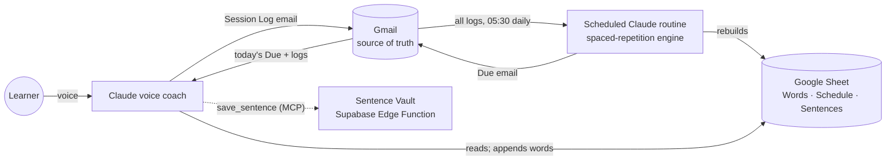

# Symloqy

**Symloqy**, from *synnoesis* (thinking together): a voice-first language lab where Claude is your sparring partner.

## Why

Vocabulary apps teach **recognition**: you know the word when you see it. They rarely teach **use**, where the word comes to you mid-sentence when you need it. Symloqy is built around use. You talk with an AI coach, out loud, every day. You retrieve words before you are told them, you build your own sentences about your own life, and you come back to each word on a spaced schedule until it becomes part of how you speak.

The method is called **Star Map Mode, not mastery**. You never "finish" a word. You orbit it through etymology, contrasts, stories and real use, until it becomes easy to reach. → [docs/METHOD.md](docs/METHOD.md)

## Reviewing this repo in 5 minutes

| Read this | To see |
|---|---|
| [voice-srs/scheduler_routine_spec.md](voice-srs/scheduler_routine_spec.md) | The production "code": a Claude routine's instructions, written as a spec |
| [voice-srs/reference/srs_schedule.py](voice-srs/reference/srs_schedule.py) and its [tests](voice-srs/reference/tests/test_srs_schedule.py) | The same rules as plain Python, with 20 unit tests for the edge cases |
| [voice-srs/coach_prompt.md](voice-srs/coach_prompt.md) | The coach prompt, plus a table of which real failure each rule fixes |
| [sentence-vault/…/index.ts](sentence-vault/supabase/functions/mcp-sentence-vault/index.ts) | A complete MCP server in about 200 lines, with no SDK |
| [docs/EXPERIMENT.md](docs/EXPERIMENT.md) | How the method will be measured, decided before seeing results |

## How it works



1. **During the day:** you say *"Start my Symloqy call."* The coach reads today's Due email and any earlier logs from today, and picks up where you left off. It runs fast recall, contrasts, stories and sentence work, and grades each word privately as `PRODUCED`, `RECALLED`, `HESITANT` or `FORGOTTEN`.
2. **Every 5 words, and at the end of the call:** the coach emails a structured **Session Log**, one line per event. → [voice-srs/log_format.md](voice-srs/log_format.md)
3. **Every morning:** a scheduled Claude routine replays every log ever sent, applies the intervals (1 → 3 → 7 → 14 → 30 days, then an "orbit pool"), rewrites the Google Sheet and emails today's **Due** list with a load-aware allowance of new words. → [voice-srs/scheduler_routine_spec.md](voice-srs/scheduler_routine_spec.md)

The details are in [docs/ARCHITECTURE.md](docs/ARCHITECTURE.md).

## The technically interesting parts

- **A scheduled Claude routine as the spaced-repetition engine.** It is an agentic workflow with no server code: a cron-triggered cloud agent with only the Gmail and Sheets connectors. It is **event-sourced**: Gmail holds an append-only log, and the schedule and sheet are rebuilt from all the logs every run, so a broken sheet or a rule change costs nothing. The logs are LLM-written and sometimes improvised, so the routine parses them best-effort, never infers a grade that wasn't stated, and treats email content strictly as data, not instructions.
- **A spec you can test.** A prompt can't be unit-tested, so the scheduling rules are also written as a small, dependency-free [Python reference](voice-srs/reference/) with tests. The tests pin down the edge cases the routine must get right: first grade of the day only, early reviews, the orbit pool, drops, the entry rule and the load-aware allowance.
- **Two agents with separate jobs.** The coach records events and never computes the schedule. The scheduler computes the schedule and never talks to the learner. The contract between them is a six-line text format.
- **A hand-written MCP server.** It implements `initialize`, `tools/list` and `tools/call` over JSON-RPC as a Supabase Edge Function in about 200 lines of TypeScript, with no SDK. It uses a constant-time bearer-key check, input validation, a service-role insert and Row Level Security. → [sentence-vault/](sentence-vault/)
- **Claude Vision for visual memory anchors (experiment).** Given a photo and 25 candidate words, Claude picks the ones that connect to something *literally visible* and returns strict JSON with anchors, memory cues and a story set in the scene. → [experiments/kindle-srs/](experiments/kindle-srs/)
- **Prompt and context engineering.** The coach prompt went through **5 versions**: four on ChatGPT Voice, then a move to Claude. Each version fixed a failure seen in real use:
  - Calls drop, so the coach rebuilds its state from email on every resume.
  - Words from the conversation leaked into the schedule, so only words from the Due email and the sheet's queue are scheduled.
  - "Never edit the sheet" made Claude refuse to add a word the learner asked for, so the prompt now allows exactly one kind of write, an append.
  - A new-word allowance of 0 made new words vanish, so the allowance never drops below 1.

  → [voice-srs/coach_prompt.md](voice-srs/coach_prompt.md)

## Status

| Part | Status |
|---|---|
| **Voice SRS** (coach + scheduler) | **In daily personal use since 2026-11-14.** This is early, with one user, the author. |
| **Sentence Vault** (MCP server) | **Working**, but no longer used. In the end, a simple Google Sheet was enough: best sentences now go into the `Sentences` tab through the email log. |
| **KindleSRS** (Claude Vision) | **Prototype.** The photo idea is suspended. |
| Tests | Unit tests for the scheduling rules (20) and the KindleSRS logic that needs no network (12), run in CI on every push. The live routine itself is checked by comparing its Due emails with the reference. |

There are no user numbers or performance metrics, and there won't be any until the experiment below reports.

## Timeline

| When | What |
|---|---|
| April 2026 | KindleSRS: Kindle highlights plus your own photos, with memory anchors from Claude Vision |
| October 2026 | Sentence Vault: a hand-written MCP server for saving best sentences from a voice assistant |
| 9 Nov 2026 | Voice SRS v1: coaching prompts for ChatGPT Voice and the first scheduler spec |
| 14 Nov 2026 | The Google Sheet becomes the word queue. First Claude voice session. Daily use begins. |
| 15 Nov 2026 | Sentences tab, sentence recall and word links |
| Nov 2026 | Experiment started (see below). The project was renamed **Symloqy**. |

## Roadmap: one lab, several senses

Everything stays inside Symloqy: the same session log, the same scheduler and the same grades. New **session types** add new ways into a word.

| Session type | Idea | Status |
|---|---|---|
| **Symloqy** (voice) | Talk your way into words | In daily use |
| **Symlopic** (sight) | Two ideas. First, Claude looks at a photo or a shared screen and you describe it together using your due words. Second, each saved best sentence becomes a light sketch, and you recall the sentence from the sketch. The images are generated by an outside image model (Gemini), and Claude does the coaching. | Next. It builds on what KindleSRS taught: random photos didn't create emotional anchors, but images made *from your own sentences* might. |
| **Symlody** (sound) | Words through music and audio | Idea |

Each session type would log a `MODE:` line, so the experiment can compare them.

## The experiment

A 30-day experiment with a control group: 20% of new words are randomly held out of reviews, and then all words are tested cold, from meaning to word. → [docs/EXPERIMENT.md](docs/EXPERIMENT.md). **Results: coming.**

## Setup

**Voice SRS** (no code to deploy):
1. Create a Google Sheet named **Symloqy SRS** with the tabs `Words`, `Schedule`, `Sentences` and `Dropped`. Note its ID.
2. Fill in the placeholders (`you@example.com`, `<YOUR_SHEET_ID>`, `<YOUR_TIMEZONE>`) in [voice-srs/scheduler_routine_spec.md](voice-srs/scheduler_routine_spec.md) and create a **scheduled Claude routine** that runs it daily at 05:30. Give it only the Gmail and Google Sheets connectors.
3. Put [voice-srs/coach_prompt.md](voice-srs/coach_prompt.md) somewhere your assistant can read it. For Claude voice, a Google Doc plus a one-line pointer in your profile preferences works. Turn on the Gmail, Sheets and Drive connectors in the chat.
4. Add the two Gmail filters described in the spec. Never delete the logs.
5. Type a few words into the `Words` tab and say *"Start my Symloqy call."*

**Sentence Vault:** see [sentence-vault/README.md](sentence-vault/README.md). In short: link your project, run the migration, run `supabase secrets set SENTENCE_VAULT_API_KEY=…`, then `supabase functions deploy mcp-sentence-vault --no-verify-jwt`.

**KindleSRS:** see [experiments/kindle-srs/README.md](experiments/kindle-srs/README.md). In short: run `pip install -r requirements.txt`, fill in `.env` from `.env.example`, run `schema.sql`, then run `python main.py` once a day.

All configuration comes from environment variables, and every `.env.example` contains placeholders only.

## Repository layout

```
docs/                 method, architecture, experiment, demo storyboard
voice-srs/            coach prompt, scheduler routine spec, log format   ← flagship
  reference/          the scheduling rules as tested Python
sentence-vault/       MCP server (Supabase Edge Function) + migration
experiments/kindle-srs/  Claude Vision word-anchoring pipeline (Python)
```

## Author

Built by Marco Africani, a former maths teacher turned applied AI engineer. Developed with Claude Code.
LinkedIn: [www.linkedin.com/in/afrimath](https://www.linkedin.com/in/afrimath)

License: [MIT](LICENSE)
