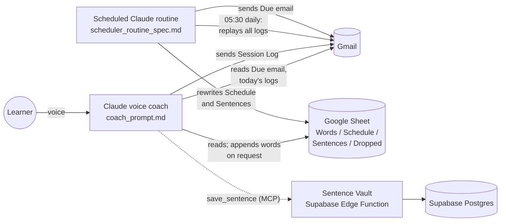

# Architecture

Symloqy has three parts. Only the first one, **Voice SRS**, is in daily use.



## 1. Voice SRS: the flagship, with no server code

| Component | Runs on | Role |
|---|---|---|
| **Voice coach** | A Claude chat with voice, plus the Gmail, Sheets and Drive connectors | Runs the session: retrieval, sentences, contrasts, stories. It grades each word and emails a structured **Session Log**. |
| **Gmail** | Learner's own mailbox | The **source of truth**. Every log is kept forever, and the schedule is a pure function of all the logs. |
| **Scheduler** | A scheduled Claude routine (cron, cloud) with Gmail and Sheets connectors | Every morning it replays all logs oldest first, applies the interval rules and sends the **Due** email. It also rebuilds the Schedule and Sentences tabs. |
| **Google Sheet** | Google Sheets | The human-facing view and input queue. The learner types new words in the Words tab. Everything else in the sheet can be rebuilt. |

**Why this shape**
- **Event sourcing over email.** The coach only *appends* events, and the scheduler *derives* state. If the sheet gets corrupted or a rule changes, the next run rebuilds everything from the logs.
- **The two agents have separate jobs.** The coach never computes the schedule, and the scheduler never talks to the learner. Each prompt stays small and testable on its own.
- **Robust to dropped calls.** On every start or resume, the coach rebuilds its state from today's Due email and Session Logs, so a dropped call loses at most a few items.
- **Untrusted input.** Logs are written by an LLM, and sometimes in an improvised format. The scheduler parses them best-effort, never infers grades that weren't stated, and treats email content as data, never as instructions.
- **Assistant-agnostic.** Any assistant that can send email in the log format can be the coach. Versions 1–4 of the prompt ran on ChatGPT Voice and version 5 runs on Claude.

## 2. Sentence Vault: an MCP server, working but superseded

A minimal **Model Context Protocol** server, hand-written in TypeScript and deployed as a **Supabase Edge Function** (Deno).

```
assistant ──POST JSON-RPC──► Edge Function ──insert──► sentence_vault (Postgres, RLS on)
           Authorization: Bearer <API key>
```

- It implements just enough of the spec for a non-streaming remote connector: `initialize`, `tools/list`, `tools/call`, and notifications answered with `202`.
- It exposes one tool, `save_sentence` (sentence, keyword, category, tags, source).
- Auth is a shared bearer key checked inside the function. The function is deployed without Supabase JWT checks. It writes to the database with the service-role key, and Row Level Security blocks the public key.
- It doesn't use an MCP SDK, because a single tool doesn't justify the dependency.
- **Status:** working. It was superseded by something simpler: Voice SRS captures sentences as `BEST:` lines in the email log, and the scheduler collects them in the sheet's `Sentences` tab. The voice assistant's plugin platform kept changing, and a spreadsheet turned out to be enough.

## 3. KindleSRS: an experiment with visual memory anchors

A Python batch job, run once a day.

```
Readwise API (Kindle highlights) ──► srs_words ─┐
Google Drive photo folder ─────────► srs_photos ─┼─► Claude Vision ──► srs_cards + story ──► HTML email (Gmail SMTP)
                                                 │   (choose N words that are
                                                 │    literally visible in the photo)
                                        Supabase Postgres
```

- **Claude Vision** receives a compressed photo (at most 1200 px, JPEG; HEIC is supported) and a pool of 25 candidate words. It returns JSON: a scene description, the 3 words with the strongest *literal* visual link, a visual anchor and memory cue for each, and a short story set inside the photo.
- `enrich.py` adds more words to an existing photo using only the saved text description, which is cheaper and needs no image.
- **Status:** prototype. The photo-anchoring idea is suspended, and development has moved to Voice SRS.

## Tech summary

| Layer | Technology |
|---|---|
| Agents | Claude (voice chat, scheduled routines, Vision API) |
| Agent tools | Gmail and Google Sheets connectors; a custom MCP server |
| Backend | Supabase Edge Functions (Deno, TypeScript), Supabase Postgres |
| Batch | Python 3.10+, Anthropic SDK, Google Drive API, Readwise API, Pillow |
